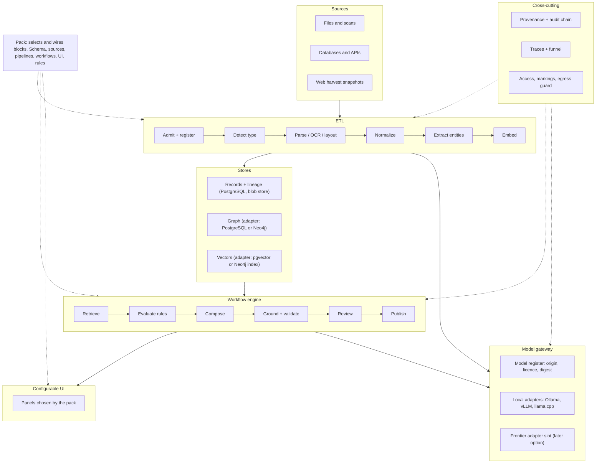

# SI — General Architecture

| | |
|---|---|
| Version | 0.4 |
| Date | 2026-11-21 |
| Owner | Adam, Teamworx Innovations |
| Name | `si`, from the repository `teamworxAI/si`. The product name is undecided. |
| Status | Design for approval. Nothing is built. |

This is a net-new, Teamworx-owned platform. It takes the best pieces of the existing
builds and makes one configurable product. Evidence for what exists is in the
portfolio review of 2026-11-21, which the owner holds outside this repository. Items
marked **[verify]** were not checked on the date above.

## 1. Rulings this design rests on (2026-11-21)

| # | Ruling | Effect |
|---|---|---|
| 1 | Net new. One configurable platform, built from lessons and best pieces of all PoCs. | This repository, `teamworxAI/si`. Torque and the others continue as they are. |
| 2 | Teamworx owns this code. MIT for now, to be revisited at go-to-market. | `LICENSE` is MIT, copyright Teamworx Innovations. No SFU data or fixtures in the repo. |
| 3 | No Chinese models. | Enforced by a model register with an origin allowlist that covers base models. |
| 4 | Air-gapped. | Empty egress allowlist by default, failing closed. Offline install bundle. |
| 5 | Frontier models through a secure custom deployment in AWS or Azure are a later option only. | A reserved adapter slot in the model gateway. Not built in v1. |
| 6 | Dual use means civil plus defence customers. | Markings, compartments and controlled-data admission are in the core. |
| 7 | Graph and vector store: both options, as needed. | One store interface with two adapters (section 4.3). |
| 8 | The first reference configuration is `maintenance`. | Build sequence, section 9. |
| 9 | Generic platform. The ingredients are building blocks, configured for each client and use case. Nothing is baked in. | Section 5. The platform ships no use case. Every use case is configuration over a block catalogue. |

## 2. What the platform does

Many data sources go through ETL into three stores: records, a graph and vectors.
Configurable workflows answer from those stores. A configurable UI presents them. One
set of observability, provenance and monitoring runs under all of it.

The platform itself contains no use case. It is a catalogue of building blocks with
typed contracts, plus the services every block shares. A use case is a **pack**: a
configuration that selects blocks, wires them and sets their parameters. A client
deployment enables one or more packs and sets its own profile. Nothing about
maintenance manuals, research papers or any other domain lives in platform code.

Two reference configurations are kept as acceptance tests, because they stress
different blocks. They are examples, not the product:

- `maintenance`: Torque-style. Manuals, parts diagrams linked to parts lists, cited
  answers, reviewed procedure drafts.
- `research`: cited retrieval over a document corpus, including scanned material.

The principle is unchanged from every PoC: AI is the interface, not the source of
truth. Records and rules produce the answer, the model words it, a deterministic check
judges the wording, and a human approves anything that publishes.

## 3. Overview



## 4. Components

### 4.1 Sources and connectors

One connector interface, three kinds at first: file drop (PDF, scans, DOCX, PPTX,
XLSX/CSV, HTML, images, audio), database or API pull, and a harvest snapshot bundle
(harvesting needs a network, serving must not, so only a verified bundle crosses).

Every source passes one admission point before anything else touches it. Admission
records the release basis, the export-control and classification markings as typed
fields, the checksum and who asserted them. A source with no release basis is refused.

### 4.2 ETL

Admit, detect type from content, one ledger row per file, parse or OCR, normalize,
extract entities and relations, embed. Incremental, idempotent, resumable.

Binding rules carried from the PoCs: ingest accounting adds up (`parsed + skipped =
input`), "unknown" is a typed state, fragments are refused, every field records how it
got its value, and every derived object stores the version of what it was built from.

An ETL pipeline is an ordered list of blocks declared in the pack (section 5). Domain
extraction, such as linking diagram callouts to parts rows, is a block like any other
and is present only where a pack asks for it.

### 4.3 Stores

| Store | Holds | Technology |
|---|---|---|
| Records | Source revisions, typed records, lineage, rules, review queue, audit chain | PostgreSQL, plus a content-addressed blob directory. Always present. |
| Graph | Entities, relationships, document structure, hotspots to parts | Adapter A: PostgreSQL (Apache AGE, or relational edges). Adapter B: Neo4j Community. |
| Vectors | Passage and entity embeddings | Adapter A: pgvector. Adapter B: Neo4j vector index. |
| Queue | Jobs and GPU leases only | Valkey |

Platform code talks to one graph-and-vector interface. A deployment picks the adapter
in its config file. Adapter A is one service fewer and carries no GPL bundle. Adapter B
is what eleven of the fourteen existing repos already run, so their loaders port
directly. One contract test suite runs against both, and a pack may not depend on
behaviour only one adapter has.

- Records are append-only revisions enforced by database triggers. A human decision
  can only be superseded by another human revision.
- Retrieval order is fixed: exact identifiers first, keyword second, graph and vectors
  after. Vectors rank; they never set a threshold.
- Access filters are applied inside the query, before retrieval.
- Graph and vectors are derived and rebuildable from the records store. PostgreSQL is
  the system of record under either adapter.

### 4.4 Workflow engine

A workflow is an ordered list of blocks declared in the pack. It is not a general
graph engine in v1. The engine validates the wiring at load time, runs the blocks in
order, and wraps each in a trace span and a provenance record.

Blocks that can change what a user is told come in two kinds, and the engine enforces
the difference: model blocks may only propose wording, and deterministic blocks decide.
A workflow that publishes must contain a grounding block and a human review block, or
the pack fails to load.

### 4.5 Configurable UI

One web shell and a registry of panels. The pack lists which panels appear, their
labels and their order. First panels: ask with citations, document and figure viewer
with hotspots, graph explorer, review queue, corpus manager with skip ledger and
lineage, funnel, and admin.

Languages come from one enabled list. UI text comes from reviewed catalogues, never
from run-time model translation. English and French ship first.

### 4.6 Model gateway and register

- One internal OpenAI-compatible endpoint. No component calls a model server directly.
- Separate configuration per pass: OCR/vision, extract, embed, rerank, compose, audit,
  speech in, speech out.
- **Model register.** One entry per model: publisher, country, base model and its
  origin, licence, weight digest, approver, date. The gateway refuses a model that is
  unregistered, fails the origin allowlist on any ancestor, or does not match its
  digest. A test proves a model with a disallowed base fails to load.
- **Data-class gate.** Each route declares which data classes it may receive.
  Restricted data is never embedded or sent to any model.
- **Frontier slot.** The adapter interface and the data-class gate are designed so an
  AWS or Azure private endpoint can be added later as one adapter and one allowlist
  entry. The air-gapped image never contains that adapter.

### 4.7 Observability, provenance and monitoring

| Concern | Mechanism |
|---|---|
| Tracing | OpenInference spans around every step, retrieval, model and tool call. Inputs and outputs hidden by default. Traces stay on the box. |
| Provenance | Every record, hotspot, vector and answer carries source revision, method, parser and model versions, actor and timestamp. |
| Audit | Hash-chained, append-only log with a verify command. |
| Monitoring | A funnel page computed from the database at request time. Health and readiness endpoints. |
| Supply chain | Pinned dependencies, SBOM per image, image scan, licence register checked in CI, signed offline bundle. |

### 4.8 Deployment

Docker Compose. Only the inference server runs on bare metal. Every port and host is
configuration, in a reserved non-default block, published on loopback only. Stack
services sit on an internal network. One config file holds the boundary and the egress
allowlist, enforced at the network and again at startup.

## 5. Building blocks and configuration

### 5.1 What a block is

A block is one generic capability with:

- a typed input and output contract, so incompatible wiring fails when the pack loads,
  not at run time;
- a parameter schema, with every default in versioned configuration;
- its own tests, including one against a toy pack that has nothing to do with any real
  domain;
- a trace span and a provenance record on every run;
- a declared kind: `model` (may propose) or `deterministic` (may decide).

### 5.2 The catalogue

| Family | Blocks (first set) | Drawn from |
|---|---|---|
| Connect | file drop, database or API pull, harvest snapshot bundle | sfu-site, jd-assistant |
| Admit | release basis, markings, checksum, refusal | Teamworx-Torque |
| Parse | PDF text, OCR, DOCX and PPTX, tables, HTML, images, speech to text | campus-ai, Teamworx-Torque |
| Extract | sections and passages, schema-driven entities and relations, table rows to typed records, figure callouts | jd-assistant, Teamworx-Torque |
| Relate | exact and near duplicate tiers, clustering, linking across records | jd-assistant |
| Index | keyword, graph, vector | all |
| Retrieve | exact identifier, keyword, graph traversal, vector, merge, access filter | sfu-site, student-assistant |
| Decide | rule evaluation, validation, scoring against a rubric | jd-assistant, recruiter-assistant |
| Word | compose, rewrite field by field, query rewrite, describe an image | all |
| Check | ground against cited records, quote verification, carry-through | Teamworx-Torque, recruiter-assistant |
| Review | queue, approve or edit or reject, ratify a rule, publish | jd-assistant |
| Present | ask with citations, document and figure viewer, graph explorer, review queue, corpus manager, funnel, admin | all |
| Export | document templates, API | jd-assistant |

Shared services are not blocks and cannot be configured away: the model gateway and
register, the records store and lineage, the audit chain, tracing, access control and
the egress guard.

### 5.3 A pack

```
packs/<name>/
  pack.yaml          entity and relation types, document types, record fields
  sources.yaml       connect and admit blocks, with parameters
  pipelines/*.yaml   ordered parse, extract, relate and index blocks
  workflows/*.yaml   ordered retrieve, decide, word, check and review blocks
  ui.yaml            present blocks, labels, order
  rules/             rule definitions and their register
  profiles/*.yaml    variants: vocabulary, labels, safety wording only
  fixtures/          public test corpus with recorded provenance
```

A pack is data only. If a client needs a capability the catalogue lacks, it is added to
the catalogue as a generic block, through the same gates, and then configured.

A **deployment profile** sits above packs and is per client: which packs are enabled,
languages, branding, SSO settings, the graph adapter, the model map and the egress
allowlist.

### 5.4 How "nothing baked in" is enforced

| Rule | Test or gate |
|---|---|
| The platform repository ships no pack outside `examples/` and `tests/packs/` | Repository layout test |
| No pack name, variant name or domain vocabulary appears in platform code | Scan of string constants and identifiers against every pack's vocabulary |
| Every block passes its tests on the toy pack | Per-block contract tests |
| A pack that wires incompatible blocks, or publishes without grounding and review, fails to load | Loader tests |
| A second reference configuration may add blocks but may not change the core or an existing block's contract | Diff gate on `research` |
| Both reference configurations pass end to end on the same platform commit | Release gate |

## 6. Models under the no-Chinese rule

Every pick below is already in use in one of the existing repositories.

| Pass | Pick | Publisher | Already used in |
|---|---|---|---|
| Compose | gpt-oss:20b | OpenAI (US) | recruiter-assistant, Knowledge-engine |
| Audit | gpt-oss:120b | OpenAI (US) | Knowledge-engine |
| Text and vision alternative | Gemma 4 | Google (US) | Teamworx-Torque, campus-ai |
| Embed (text) | nomic-embed-text | Nomic (US) **[verify]** | most repos |
| Embed (multimodal) | EmbeddingGemma 2 | Google (US) | campus-ai |
| OCR | Tesseract | open-source project | Teamworx-Torque |
| Document layout | Docling with Granite-Docling | IBM (US) | campus-ai research |
| Speech in | whisper.cpp | OpenAI weights (US) | Torque ADR-TT-014 |
| Speech out | Not chosen | | Open in Torque (Q24) |
| Rerank | Not chosen | | campus-ai's pick was Qwen3-Reranker, now excluded |

Excluded families seen in the repos: Qwen, DeepSeek, GLM, PaddleOCR, BGE, and any
fine-tune of them (olmOCR 2 is built on Qwen2.5-VL). Licences must be confirmed per
model before the register entry is approved **[verify]**.

## 7. What is taken from where

| Piece | Taken from |
|---|---|
| Harness, one verify gate, evidence contract, rulings register | Teamworx-Torque |
| One config file, egress boundary, loopback port block | Teamworx-Torque ADR-TT-009, 010 |
| Append-only revisions by trigger, purity rule for core modules | Teamworx-Torque ADR-TT-003, 004 |
| Diagram hotspots, grounding rules, source register, markings | Teamworx-Torque |
| Language list, UI catalogues | Teamworx-Torque ADR-TT-013 |
| Offline bundle, installers, SBOM, licence register, GPL source offer, stripped Neo4j image | Knowledge-engine |
| Per-pass model config, digest recording | Knowledge-engine |
| Licence guard test, data-class gate, model register | campus-ai |
| Document parsing for DOCX, PPTX, PDF, math, alt text | campus-ai |
| Ingest ledger, dedup tiers, policy book, review queue, audit chain | jd-assistant |
| Quote verification against source chunks | recruiter-assistant |
| Harvest-to-serve snapshot bundle, graph loader, hybrid retrieval | sfu-site |
| SSO and RBAC | jd-assistant, recruiter-assistant |

Code is ported with its tests, and each port records the source commit.

## 8. Open decisions

Numbered questions, working assumptions and rulings live in
[open-questions.md](open-questions.md). Still open on the date above: the read-aloud
engine, the reranker, whether Phoenix ships in the product, the licence at
go-to-market, and the outcome metric.

## 9. Build sequence

Knowledge-engine built a complete platform and no engine. The sequence below is ordered
so that cannot repeat: the first milestone is a thin slice through every layer.

1. `bootstrap`: harness ported from Torque, licence, config file, egress guard.
2. `block-contracts`: block interface, typed contracts, pack loader and validator, the
   toy pack, the no-domain-vocabulary scan.
3. `core-services`: records store with lineage, audit chain, tracing, a thin model
   gateway with the register.
4. `first-chain`: the smallest set of blocks that runs end to end from one config:
   admit, parse PDF text, index, retrieve, compose, ground, ask panel. The config is
   `examples/maintenance`, on one public manual, offline. Graph and vectors on
   adapter A.
5. `ocr-and-figures`: OCR, table rows, figure callouts, the figure viewer.
6. `decide-and-review`: rule evaluation, validation, review queue, publish.
7. `graph-neo4j`: adapter B, passing the same contract suite.
8. `access`: SSO, roles, markings, compartments.
9. `second-config`: `examples/research`, under the diff gate in section 5.4.
10. `release`: offline bundle, SBOM, licence register, signing.
11. `frontier-slot`: only when a customer needs it.

Item 4 is the guard against building a platform that runs nothing: by then one real
configuration must answer a question end to end.

Every item names the outcome metric it moves and ships through `verify.sh full`.

## 10. Evidence

| Claim | Source |
|---|---|
| What exists in each repo, model defaults, licences | Portfolio review of 2026-11-21, sections 2 to 6 and 9 (held by the owner) |
| Rulings in section 1 | The owner's rulings of 2026-11-21, recorded in open-questions.md |
| olmOCR 2 base model | https://lmstudio.ai/models/allenai/olmocr-2-7b-1025 (read 2026-11-21) |
| Phoenix licence | https://arize.com/docs/phoenix/self-hosting/license (read 2026-11-21) |
| Neo4j Community licence | https://neo4j.com/licensing/ (read 2026-11-21) |
| Apache AGE and pgvector licences | Not checked **[verify]** |
| Publisher countries not stated in a repo | General knowledge, marked **[verify]** where it matters |

For the later frontier option, as read on 2026-11-21: Amazon Bedrock's Canada
cross-Region profile covered Claude Haiku 5.5 only, and Microsoft Foundry listed no
Canada region for Claude. Re-check when the option is taken up.
